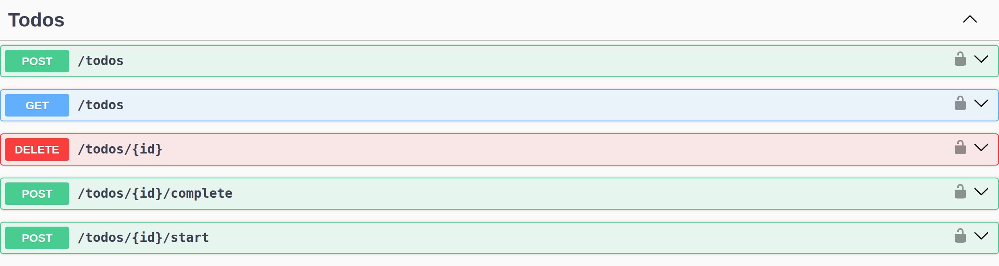
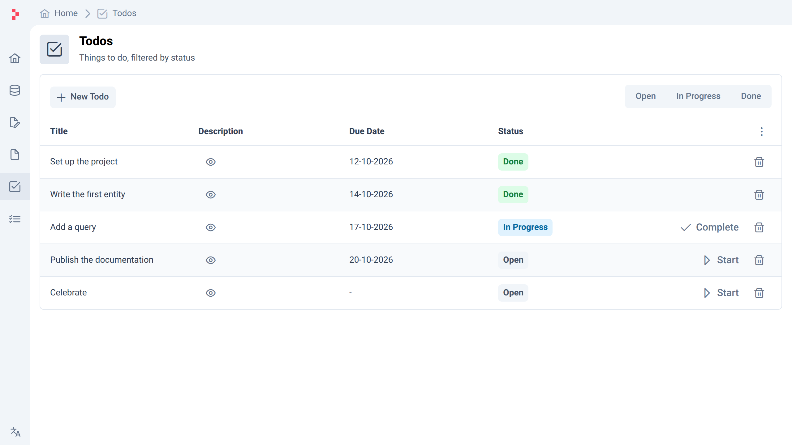

---
sections:
    - recipes
    - features
    - layers
    - architecture
    - release-notes
---

::banner

# Bake your domain objects
## into a web application

Baked is an opinionated framework for .NET and Vue that turns your domain
objects into a REST API and a UI by convention.

::

::columns

#code

### From Code

Write a domain object;

```csharp
public class Todo(IEntityContext<Todo> _context)
{
    public Id Id { get; private set; } = default!;
    public string Title { get; private set; } = default!;
    public string? Description { get; private set; }
    public DateOnly? DueDate { get; private set; }
    public TodoStatus Status { get; private set; } = default!;

    public Todo With(string title,
        string? description = default,
        DateOnly? dueDate = default
    )
    {
        Title = title;
        Description = description;
        DueDate = dueDate;
        Status = TodoStatus.Open;

        return _context.Insert(this);
    }

    public void Start() =>
        Status = TodoStatus.InProgress;

    public void Complete() =>
        Status = TodoStatus.Done;

    public void Delete() =>
        _context.Delete(this);
}

public class Todos(IQueryContext<Todo> _context)
{
    public List<Todo> By(TodoStatus? status = default) =>
        _context.By(t => status == default || t.Status == status);
}

public enum TodoStatus
{
    Open = 001,
    InProgress = 100,
    Done = 200
}
```

#result

### To API

Baked generates a REST API with Swagger documentation;



### And UI

And a UI for it;



::

## How It Works

Explore how recipes build applications using built-in features and layers, and
how to extend them with your own.

::columns

#recipes

### Recipes

Use built-in recipes to bake an application with minimal effort. These
pre-configured templates streamline setup, letting you focus on development.

[See more](recipes/README.md)

#ingredients

### Extensions

Use features and layers as ingredients to create your own recipe. Customize your
application by combining different components to fit your specific needs.

[Features](features/README.md) [Layers](layers/README.md)

#architecture

### Architecture

Deep dive into how we've built Baked and create your own extensions. Understand
the design principles and extend the framework to suit your unique requirements.

[See more](architecture/README.md)

::
