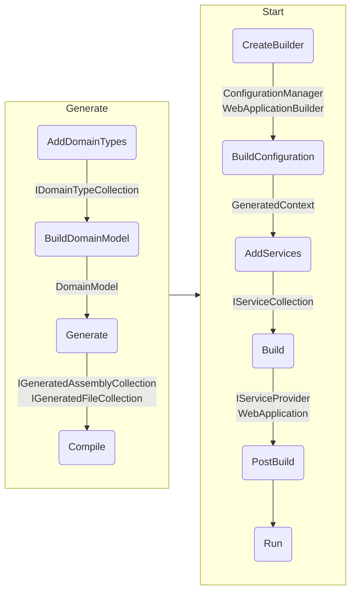
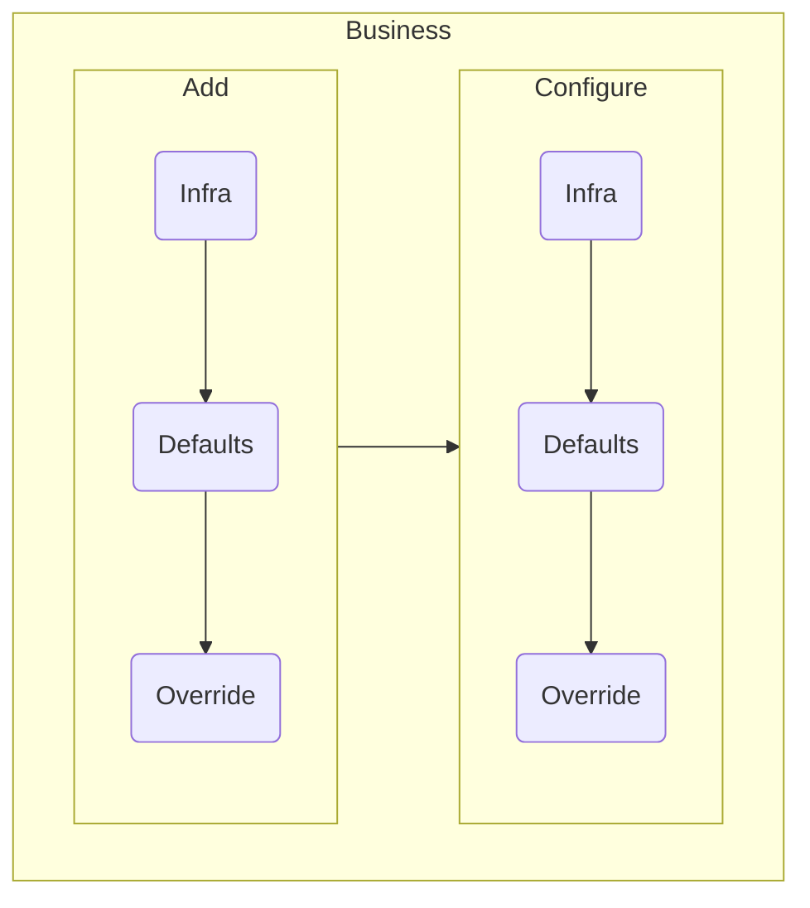

# Data Source

Data source recipe includes enough layers and feature implementations for a
backend application that is expected to provide data from configured data source
using report queries in `.sql` files.

To create an application from this recipe, use `DataSource()` extension of
`Bake` class directly in `Program.cs`.

```csharp
Bake.New
    .DataSource(
        business: c => c.DomainAssemblies([...])
    )
    .Run();
```

### Changing Defaults

Use `options:` to change a default feature of this recipe;

```csharp
Bake.New
    .DataSource(
        business: c => c.DomainAssemblies([...]),
        options: o => o.Database(c => c.PostgreSql())
    )
    .Run();
```

> [!WARNING]
>
> Default database is SQLite, which requires `Database:Sqlite:FileName` setting
> unless a file name is given, e.g., `o.Database(c => c.Sqlite("app.db"))`

## Layers

| Name            | Run                | Test               |
| ---             | ---                | ---                |
| [Buildtime][]   | :white_check_mark: | :white_check_mark: |
| [Data Access][] | :white_check_mark: | :white_check_mark: |
| [Domain][]      | :white_check_mark: | :white_check_mark: |
| [HTTP Server][] | :white_check_mark: | :no_entry:         |
| [Rest API][]    | :white_check_mark: | :no_entry:         |
| [Runtime][]     | :white_check_mark: | :white_check_mark: |
| [Testing][]     | :no_entry:         | :white_check_mark: |

## Features

| Name                   | Run                                    | Test                                      |
| ---                    | ---                                    | ---                                       |
| [Binding][]            | :white_check_mark:                     | :white_check_mark:                        |
|                        | [Rest][]                               |                                           |
| [Business][]           | :white_check_mark: (No Default)        | :white_check_mark:                        |
| [Caching][]            | :white_check_mark:                     | :white_check_mark:                        |
|                        | [In-Memory][]                          |                                           |
|                        | [Scoped Memory][]                      |                                           |
| [Coding Style][]       | :white_check_mark:                     | :white_check_mark:                        |
|                        | [Add/Remove Child as Sub Resource][]   |                                           |
|                        | [Command via Method Name][]            |                                           |
|                        | [Flags Enum][]                         |                                           |
|                        | [Initializable via Method Name][]      |                                           |
|                        | [Locate via ID][]                      |                                           |
|                        | [Name based Label][]                   |                                           |
|                        | [Namespace as Route][]                 |                                           |
|                        | [Primitive via Parsable][]             |                                           |
|                        | [Query via Plural Name][]              |                                           |
|                        | [Records are DTOs][]                   |                                           |
|                        | [Remaining Services are Singleton][]   |                                           |
|                        | [Resource via ID Initializer][]        |                                           |
|                        | [Scoped via Suffix][]                  |                                           |
|                        | [Type based ID][]                      |                                           |
|                        | [Use Built-in Types][]                 |                                           |
|                        | [Use Nullable Types][]                 |                                           |
| [Core][]               | :white_check_mark: [Dotnet][]          | :white_check_mark: [Mock][core-mock]      |
| [Database][]           | :white_check_mark: [Sqlite][]          | :white_check_mark: [In Memory][]          |
| [Exception Handling][] | :white_check_mark: [Problem Details][] | :white_check_mark:                        |
| [Greeting][]           | :white_check_mark: [Swagger][]         | :no_entry:                                |
| [Lifetime][]           | :white_check_mark:                     | :white_check_mark:                        |
|                        | [Application][]                        |                                           |
|                        | [Instance][]                           |                                           |
|                        | [Scope][]                              |                                           |
| [Localization][]       | :white_check_mark: [.NET][]            | :white_check_mark:                        |
| [Logging][]            | :white_check_mark: [Request][]         | :no_entry:                                |
| [Mocking Overrider][]  | :no_entry:                             | :white_check_mark: [First Interface][]    |
| [Rate Limiter][]       | :white_check_mark: [Concurrency][]     | :no_entry:                                |
| [Reporting][]          | :white_check_mark: [NativeSql][]       | :white_check_mark: [Mock][reporting-mock] |

> [!NOTE]
>
> When _Test_ column have :white_check_mark: without a note, this means it
> inherits whatever _Run_ column denotes.

## Phase Execution Order


## Convention Order Matrix



[Buildtime]: ../layers/buildtime.md
[Data Access]: ../layers/data-access.md
[Domain]: ../layers/domain.md
[HTTP Server]: ../layers/http-server.md
[Rest API]: ../layers/rest-api.md
[Runtime]: ../layers/runtime.md
[Testing]: ../layers/testing.md
[Binding]: ../features/binding.md
[Rest]: ../features/binding.md#rest
[Business]: ../features/business.md
[Caching]: ../features/caching.md
[In-Memory]: ../features/caching.md#in-memory
[Scoped Memory]: ../features/caching.md#scoped-memory
[Coding Style]: ../features/coding-style.md
[Add/Remove Child as Sub Resource]: ../features/coding-style.md#addremove-child-as-sub-resource
[Command via Method Name]: ../features/coding-style.md#command-via-method-name
[Flags Enum]: ../features/coding-style.md#flags-enum
[Initializable via Method Name]: ../features/coding-style.md#initializable-via-method-name
[Locate via ID]: ../features/coding-style.md#locate-via-id
[Name based Label]: ../features/coding-style.md#name-based-label
[Namespace as Route]: ../features/coding-style.md#namespace-as-route
[Primitive via Parsable]: ../features/coding-style.md#primitive-via-parsable
[Query via Plural Name]: ../features/coding-style.md#query-via-plural-name
[Records are DTOs]: ../features/coding-style.md#records-are-dtos
[Remaining Services are Singleton]: ../features/coding-style.md#remaining-services-are-singleton
[Resource via ID Initializer]: ../features/coding-style.md#resource-via-id-initializer
[Scoped via Suffix]: ../features/coding-style.md#scoped-via-suffix
[Type based ID]: ../features/coding-style.md#type-based-id
[Use Built-in Types]: ../features/coding-style.md#use-built-in-types
[Use Nullable Types]: ../features/coding-style.md#use-nullable-types
[Core]: ../features/core.md
[Dotnet]: ../features/core.md#net
[core-mock]: ../features/core.md#mock
[Database]: ../features/database.md
[Sqlite]: ../features/database.md#sqlite
[In Memory]: ../features/database.md#in-memory
[Exception Handling]: ../features/exception-handling.md
[Problem Details]: ../features/exception-handling.md#problem-details
[Greeting]: ../features/greeting.md
[Swagger]: ../features/greeting.md#swagger
[Lifetime]: ../features/lifetime.md
[Application]: ../features/lifetime.md#application
[Instance]: ../features/lifetime.md#instance
[Scope]: ../features/lifetime.md#scope
[Localization]: ../features/localization.md
[.NET]: ../features/localization.md#net
[Logging]: ../features/logging.md
[Request]: ../features/logging.md#request
[Mocking Overrider]: ../features/mock-overrider.md
[First Interface]: ../features/mock-overrider.md#first-interface
[Rate Limiter]: ../features/rate-limiter.md
[Concurrency]: ../features/rate-limiter.md#concurrency
[Reporting]: ../features/reporting.md
[NativeSql]: ../features/reporting.md#native-sql
[reporting-mock]: ../features/reporting.md#mock
