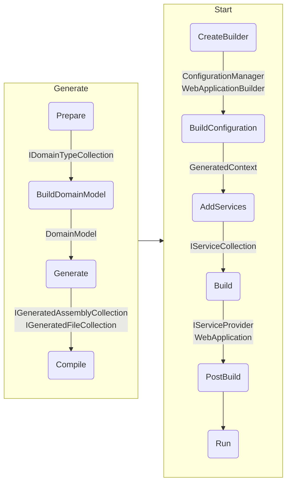
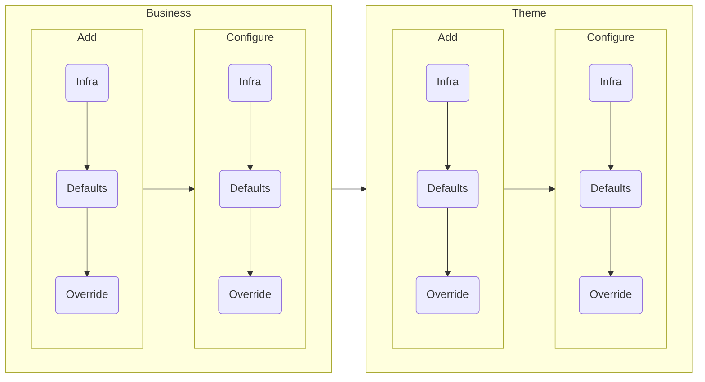

# Monolith

Monolith recipe is the default backend recipe provided by Baked which includes
necessary layers and feature implementations for any backend application.

To create an application from this recipe, use `Monolith()` extension of `Bake`
class directly in `Program.cs`.

```csharp
Bake.New
    .Monolith(
        business: c => c.DomainAssemblies([...])
    )
    .Run();
```

### Changing Defaults

Use `options:` to change a default feature of this recipe, or to add a theme
which also adds the UI layer;

```csharp
Bake.New
    .Monolith(
        business: c => c.DomainAssemblies([...]),
        options: o =>
        {
            o.Database(c => c.PostgreSql());
            o.Theme(c => c.Default(index: r => r.Index(), routes: [...]));
        }
    )
    .Run();
```

> [!WARNING]
>
> Default database is SQLite, which requires `Database:Sqlite:FileName` setting
> unless a file name is given, e.g., `o.Database(c => c.Sqlite("app.db"))`

## Layers

| Name            | Run                                 | Test               |
| ---             | ---                                 | ---                |
| [Buildtime][]   | :white_check_mark:                  | :white_check_mark: |
| [Data Access][] | :white_check_mark:                  | :white_check_mark: |
| [Domain][]      | :white_check_mark:                  | :white_check_mark: |
| [HTTP Client][] | :white_check_mark:                  | :no_entry:         |
| [HTTP Server][] | :white_check_mark:                  | :no_entry:         |
| [Rest API][]    | :white_check_mark:                  | :no_entry:         |
| [Runtime][]     | :white_check_mark:                  | :white_check_mark: |
| [Testing][]     | :no_entry:                          | :white_check_mark: |
| [UI][]          | :white_check_mark: (When Theme Set) | :no_entry:         |

## Features

| Name                   | Run                                          | Test                                          |
| ---                    | ---                                          | ---                                           |
| [Authentication][]     | :white_check_mark:                           | :no_entry:                                    |
|                        | [Fixed Bearer Token][]                       |                                               |
| [Authorization][]      | :white_check_mark: [Claim Based][]           | :no_entry:                                    |
| [Binding][]            | :white_check_mark:                           | :white_check_mark:                            |
|                        | [Rest][]                                     |                                               |
| [Business][]           | :white_check_mark: (No Default)              | :white_check_mark:                            |
| [Caching][]            | :white_check_mark:                           | :white_check_mark:                            |
|                        | [In-Memory][]                                |                                               |
|                        | [Scoped Memory][]                            |                                               |
| [Coding Style][]       | :white_check_mark:                           | :white_check_mark:                            |
|                        | [Add/Remove Child as Sub Resource][]         |                                               |
|                        | [Command via Method Name][]                  |                                               |
|                        | [Extension via Locatable Initializer][]      |                                               |
|                        | [Flags Enum][]                               |                                               |
|                        | [Initializable via Method Name][]            |                                               |
|                        | [Locate via ID][]                            |                                               |
|                        | [Name based Label][]                         |                                               |
|                        | [Namespace as Route][]                       |                                               |
|                        | [Object as JSON][]                           |                                               |
|                        | [Primitive via Parsable][]                   |                                               |
|                        | [Query via Plural Name][]                    |                                               |
|                        | [Records are DTOs][]                         |                                               |
|                        | [Remaining Services are Singleton][]         |                                               |
|                        | [Resource via ID Initializer][]              |                                               |
|                        | [Rich Entity][]                              |                                               |
|                        | [Status Enum via Suffix][]                   |                                               |
|                        | [Scoped via Suffix][]                        |                                               |
|                        | [Suffix based Client][]                      |                                               |
|                        | [Type based ID][]                            |                                               |
|                        | [Unique via SingleBy][]                      |                                               |
|                        | [`Uri` Return is Redirect][]                 |                                               |
|                        | [Use Built-in Types][]                       |                                               |
|                        | [Use Nullable Types][]                       |                                               |
| [Communication][]      | :white_check_mark: [HTTP][]                  | :white_check_mark: [Mock][communication-mock] |
| [Core][]               | :white_check_mark: [Dotnet][]                | :white_check_mark: [Mock][core-mock]          |
| [Cors][]               | :white_check_mark: Disabled                  | :no_entry:                                    |
| [Database][]           | :white_check_mark: [Sqlite][]                | :white_check_mark: [In Memory][]              |
| [Exception Handling][] | :white_check_mark: [Problem Details][]       | :white_check_mark:                            |
| [Greeting][]           | :white_check_mark: [Swagger][]               | :no_entry:                                    |
| [Lifetime][]           | :white_check_mark:                           | :white_check_mark:                            |
|                        | [Application][]                              |                                               |
|                        | [Instance][]                                 |                                               |
|                        | [Scope][]                                    |                                               |
| [Localization][]       | :white_check_mark: [.NET][]                  | :white_check_mark:                            |
| [Logging][]            | :white_check_mark: [Request][]               | :no_entry:                                    |
| [Mocking Overrider][]  | :no_entry:                                   | :white_check_mark: [First Interface][]        |
| [ORM][]                | :white_check_mark: [Auto Map][]              | :white_check_mark:                            |
| [Rate Limiter][]       | :white_check_mark: [Concurrency][]           | :no_entry:                                    |
| [Theme][]              | :white_check_mark: (No Default)              | :no_entry:                                    |
| [UX][]                 | :white_check_mark:                           | :no_entry:                                    |
|                        | [Actions as Buttons][]                       |                                               |
|                        | [Actions are Contents][]                     |                                               |
|                        | [Actions as Data Panels][]                   |                                               |
|                        | [Data Table defaults][]                      |                                               |
|                        | [Description Property][]                     |                                               |
|                        | [Enum Parameter is Select][]                 |                                               |
|                        | [Form Inputs Are Ifta Label][]               |                                               |
|                        | [Initializer Parameters are in Page Title][] |                                               |
|                        | [Labels are Frozen][]                        |                                               |
|                        | [List is Data Table][]                       |                                               |
|                        | [Numeric Values are Formatted][]             |                                               |
|                        | [Object with List is Data Table][]           |                                               |
|                        | [Panel Parameters are Stateful][]            |                                               |
|                        | [Query Action As Data Container][]           |                                               |
|                        | [Properties as Fieldset][]                   |                                               |
|                        | [Routed Types as NavLinks][]                 |                                               |

> [!NOTE]
>
> When _Test_ column have :white_check_mark: without a note, this means it
> inherits whatever _Run_ column denotes.

## Phase Execution Order



## Convention Order Matrix



[Buildtime]: ../layers/buildtime.md
[Data Access]: ../layers/data-access.md
[Domain]: ../layers/domain.md
[HTTP Client]: ../layers/http-client.md
[HTTP Server]: ../layers/http-server.md
[Rest API]: ../layers/rest-api.md
[Runtime]: ../layers/runtime.md
[Testing]: ../layers/testing.md
[UI]: ../layers/ui.md
[Authentication]: ../features/authentication.md
[Fixed Bearer Token]: ../features/authentication.md#fixed-bearer-token
[Authorization]: ../features/authorization.md
[Claim Based]: ../features/authorization.md#claim-based
[Binding]: ../features/binding.md
[Rest]: ../features/binding.md#rest
[Business]: ../features/business.md
[Caching]: ../features/caching.md
[In-Memory]: ../features/caching.md#in-memory
[Scoped Memory]: ../features/caching.md#scoped-memory
[Coding Style]: ../features/coding-style.md
[Add/Remove Child as Sub Resource]: ../features/coding-style.md#addremove-child-as-sub-resource
[Command via Method Name]: ../features/coding-style.md#command-via-method-name
[Extension via Locatable Initializer]: ../features/coding-style.md#extension-via-locatable-initializer
[Flags Enum]: ../features/coding-style.md#flags-enum
[Initializable via Method Name]: ../features/coding-style.md#initializable-via-method-name
[Locate via ID]: ../features/coding-style.md#locate-via-id
[Name based Label]: ../features/coding-style.md#name-based-label
[Namespace as Route]: ../features/coding-style.md#namespace-as-route
[Object as JSON]: ../features/coding-style.md#object-as-json
[Primitive via Parsable]: ../features/coding-style.md#primitive-via-parsable
[Query via Plural Name]: ../features/coding-style.md#query-via-plural-name
[Records are DTOs]: ../features/coding-style.md#records-are-dtos
[Remaining Services are Singleton]: ../features/coding-style.md#remaining-services-are-singleton
[Resource via ID Initializer]: ../features/coding-style.md#resource-via-id-initializer
[Rich Entity]: ../features/coding-style.md#rich-entity
[Status Enum via Suffix]: ../features/coding-style.md#status-enum-via-suffix
[Scoped via Suffix]: ../features/coding-style.md#scoped-via-suffix
[Suffix based Client]: ../features/coding-style.md#suffix-based-client
[Type based ID]: ../features/coding-style.md#type-based-id
[Unique via SingleBy]: ../features/coding-style.md#unique-via-singleby
[`Uri` Return is Redirect]: ../features/coding-style.md#uri-return-is-redirect
[Use Built-in Types]: ../features/coding-style.md#use-built-in-types
[Use Nullable Types]: ../features/coding-style.md#use-nullable-types
[Communication]: ../features/communication.md
[HTTP]: ../features/communication.md#http
[communication-mock]: ../features/communication.md#mock
[Core]: ../features/core.md
[Dotnet]: ../features/core.md#net
[core-mock]: ../features/core.md#mock
[Cors]: ../features/cors.md
[Database]: ../features/database.md
[Sqlite]: ../features/database.md#sqlite
[In Memory]: ../features/database.md#in-memory
[Exception Handling]: ../features/exception-handling.md
[Problem Details]: ../features/exception-handling.md#problem-details
[Greeting]: ../features/greeting.md
[Swagger]: ../features/greeting.md#swagger
[Lifetime]: ../features/lifetime.md
[Application]: ../features/lifetime.md#application
[Instance]: ../features/lifetime.md#instance
[Scope]: ../features/lifetime.md#scope
[Localization]: ../features/localization.md
[.NET]: ../features/localization.md#net
[Logging]: ../features/logging.md
[Request]: ../features/logging.md#request
[Mocking Overrider]: ../features/mock-overrider.md
[First Interface]: ../features/mock-overrider.md#first-interface
[ORM]: ../features/orm.md
[Auto Map]: ../features/orm.md#auto-map
[Rate Limiter]: ../features/rate-limiter.md
[Concurrency]: ../features/rate-limiter.md#concurrency
[Theme]: ../features/theme.md
[UX]: ../features/ux.md
[Actions as Buttons]: ../features/ux.md#actions-as-buttons
[Actions are Contents]: ../features/ux.md#actions-are-contents
[Actions as Data Panels]: ../features/ux.md#actions-as-data-panels
[Data Table defaults]: ../features/ux.md#data-table-defaults
[Description Property]: ../features/ux.md#description-property
[Enum Parameter is Select]: ../features/ux.md#enum-parameter-is-select
[Form Inputs Are Ifta Label]: ../features/ux.md#form-inputs-are-ifta-label
[Initializer Parameters are in Page Title]: ../features/ux.md#initializer-parameters-are-in-page-title
[Labels are Frozen]: ../features/ux.md#labels-are-frozen
[List is Data Table]: ../features/ux.md#list-is-data-table
[Numeric Values are Formatted]: ../features/ux.md#numeric-values-are-formatted
[Object with List is Data Table]: ../features/ux.md#object-with-list-is-data-table
[Panel Parameters are Stateful]: ../features/ux.md#panel-parameters-are-stateful
[Query Action As Data Container]: ../features/ux.md#query-action-as-data-container
[Properties as Fieldset]: ../features/ux.md#properties-as-fieldset
[Routed Types as NavLinks]: ../features/ux.md#routed-types-as-nav-links
